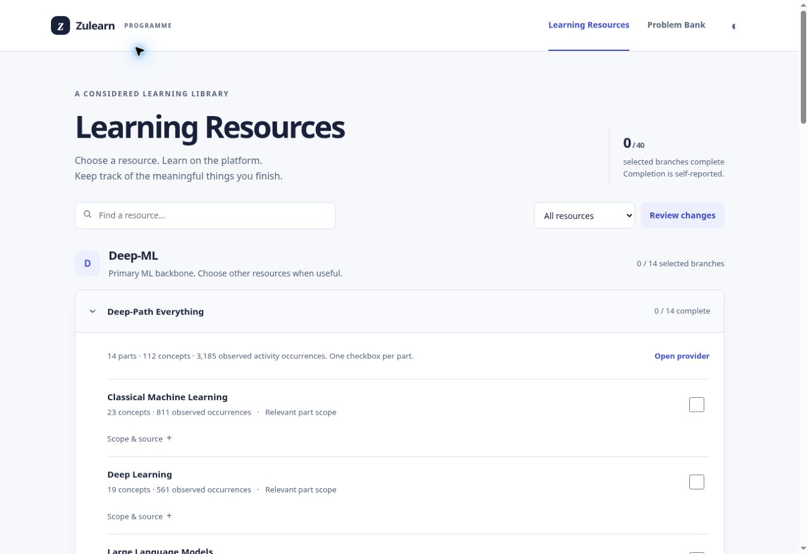

# Zulearn simplification — implementation and verification

The working website now has exactly two primary pages: Learning Resources (default) and Problem Bank. All 508 previous canonical identities and original educational objects are preserved. The protected scientific sources are unchanged.

Reviewed baseline: `0dd9efc2960ece62712b2df753663197ee7934ac`. The implementation revision is the Git commit containing this report; the delivery message gives its verified full SHA.

## Rendered interface

[Desktop dark](qa/resources-desktop-dark.jpg) · [390-pixel light](qa/resources-mobile-light.jpg) · [390-pixel dark](qa/resources-mobile-dark.jpg) · [320-pixel rendering](qa/resources-mobile-320.jpg).

Narrow screenshots show the actual production app in a CSS-sized iframe, including the surrounding desktop harness. This is real Chromium rendering, not a DOM simulation, physical phone or touch test. Both pages fit their 320- and 390-pixel CSS viewports (305/375 client pixels after native scrollbars). Desktop content/client width matched at 1348 pixels. A 320-pixel toolbar overflow was found and corrected before delivery.

## Final hierarchy and manual units

| Platform | Parent category | Named branches / observations | Initially selected manual units |
|---|---|---:|---:|
| Deep-ML | Deep-Path Everything | 14 | 14 |
| Deep-ML | Learning Paths | 13 | 0 |
| Deep-ML | Labs | 120 | 0 |
| Deep-ML | Projects | 157 | 0 |
| Deep-ML | Collections | 24 | 0 |
| Deep-ML | Courses | 2 | 0 |
| Deep-ML | Math | 24 | 0 |
| Deep-ML | Intuition | 16 | 0 |
| TensorTonic | Study Plans & Roadmap | 34 | 2 |
| TensorTonic | Projects | 28 | 0 |
| TensorTonic | Research Paper Tracks | 29 | 0 |
| TensorTonic | Labs | 1 | 0 |
| TensorTonic | ML System Design | 58 | 0 |
| TensorTonic | Articles | 8 | 0 |
| Zulearn | Lessons | 2 | 2 |
| Zulearn | Problem Bank | 9 | 0 |
| Zulearn | Selected Courses | 5 | 5 |
| Zulearn | Research Papers | 17 | 17 |
| **Total** | **18 categories across 3 platforms** | **561** | **40** |

The full named hierarchy, source links, unresolved identities and explicit completion scopes are in [resources.json](resources.json). Deep-ML Math groups retain all 861 card observations; Intuition retains all 130 puzzles in 16 thematic sets. All 1,853 original catalogue observations remain in their unchanged source file. The 34 TensorTonic plan/roadmap branches preserve 21 plans and 13 roadmap modules; all 29 paper-track names and 58 system-design topic/case names remain discoverable. Project release observations are explicitly not claimed unique projects.

The 40 default selections consist of 14 primary Deep-Path parts and 26 complementary branches (two TensorTonic selections, two opening chapters, five bounded university selections, 17 paper assignments). Nonprimary selections can be removed. Other catalogue resources can be selected with an explicit scope; nine unverified thematic problem sets remain outside the confirmed checklist. There is no fourth LeetCode platform group.

| Tracking measure | Before | After |
|---|---:|---:|
| Selected manual units | 222 | 40 |
| Mandatory Deep-Path concepts | 112 | 0 |
| Manual Deep-Path parts | 0 (14 derived) | 14 |
| Individual TensorTonic task checkboxes | 11 | 0 (two bounded branches) |
| Canonical registry identities | 508 | 994, including all original 508 |

`UNIT-DP-01`–`UNIT-DP-14` are reused. Parent summaries derive from selected branches. No part completion creates concept/problem records or independent-mastery evidence. Full provider completion and a local complementary selection have distinct scope labels. The two TensorTonic selections do not certify a full course or roadmap module.

## Complementary-practice result

**Zero unique complementary gaps are confirmed.** This is an unresolved curation result, not a claim that the providers cover everything.

| Source | Count | Current treatment |
|---|---:|---|
| Existing original exercises | 46 | Preserved; pending complementary verification |
| Approved worksheets | 52 | Preserved; pending complementary verification |
| Exact external locators | 17 | Preserved; pending complementary verification |
| Conditional LeetCode identities | 4 | Three thematic sets; pending complementary verification |
| Conditional TensorTonic tasks | 11 | Native referrals; no recreated problem statements |

Every one of these 130 items has a target, candidate gap, relevant inspected evidence or an explicit evidence limitation, insufficiency decision, provenance and evaluation/review method in [complementary-audit.json](complementary-audit.json). The 119 pending candidates are available behind an explicit pending-review disclosure and excluded from the confirmed workload. The bank remains functional: thematic browsing, source links, retained written practice, hints/criteria, and exact rational checking for existing numeric exercises. No exercise body, answer form, hint or solution is rendered inside Learning Resources. No new exercise was authored.

The existing generic leakage exercises cannot be presumed unique: the inspected TensorTonic lesson already covers entity/time splits, near-duplicates, train-only fitting and test reuse. The public Deep-ML split lab reader did not expose its full task body. Catalogue-level comparisons cannot establish exhaustive adequacy. Topic matches are candidate comparisons, not duplicate declarations. External statements/solutions remain at their original sources (MathNet, AoPS, OTIS, MIT, Harvard, Stanford, Putnam and approved literature).

## Progress and regression

`docs/progress.json` remains byte-identical and empty. It is the single authoritative committed completion/selection store. Staged changes exist only in tab memory. The browser honestly states that it cannot commit them. Theme preference is the only local-storage setting.

Production [model.js](model.js) implements first-level branch validation, selection/scopes, record preconditions, conflict detection and batch merge. The helper [progress-batch.cjs](../scripts/progress-batch.cjs) writes a separate authorized, validated proposal. Publishing still requires latest GitHub blob/HEAD protection and read-back. The website can verify the latest committed raw GitHub file; this verification succeeded during the actual browser checks. Undo, discard, clipboard copy, numeric checking, search and selection were also exercised without writing learner records.

**203 regression assertions passed** against production JavaScript and actual data. They cover hierarchy/IDs, preserved content, alias resolution, manual-unit boundaries, aggregate semantics, optional selection, no constituent/mastery inflation, unauthorized updates, concurrent record/scope conflicts, scope-reset requirements, unrelated-record/pointer preservation, exact arithmetic and protected source bytes.

**83 protected source files are byte-identical** to the baseline, including all 30 frozen curriculum files, 109-competency data, prerequisite architecture, 112-concept catalogue, teaching materials and scientific assessment definitions. [SHA-256 manifest](qa/protected-sha256.json) · [structured acceptance receipt](qa/acceptance.json).

## Remaining limits

Full cross-platform complementary curation and exercise-level deduplication remain open. Zero exact cross-platform duplicate pairs are verified; eleven existing TensorTonic observation aliases remain canonical. Most Deep-ML individual URLs and current thematic-path identities remain unavailable. TensorTonic's complete project inventory and roadmap 122-versus-125 count are unresolved. Article hub/series retrieval now agrees on 20 published LLM guides; upcoming topics are not assigned. The website has no dependency on finishing these investigations.

Browser QA is a scoped visual/interaction check, not an assistive-technology conformance certification or evidence of learning efficacy. Completion, coverage, independently demonstrated mastery and research ability remain distinct.
